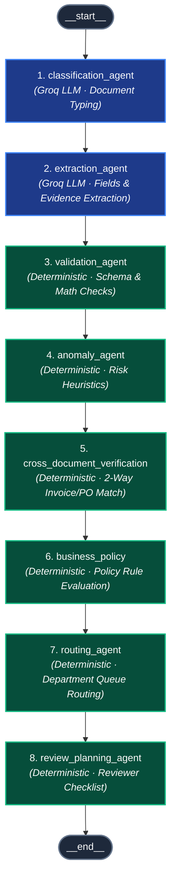

# 📄 AI-Based Intelligent Document Processing System (IDP)

[](https://www.python.org/)
[](https://fastapi.tiangolo.com/)
[](https://www.langchain.com/langgraph)
[](https://react.dev/)
[](https://groq.com/)
[](https://sqlite.org/)
[](https://vitejs.dev/)

An enterprise-grade, privacy-first **Intelligent Document Processing (IDP) Prototype** combining high-speed LLM vision extraction with deterministic validation, two-way invoice-to-purchase-order matching, corporate policy enforcement, and role-based human-in-the-loop review.

---

## 📑 Table of Contents
- [Key Innovations](#-key-innovations)
- [System Architecture & Processing Flow](#-system-architecture--processing-flow)
- [Supported Document Types](#-supported-document-types)
- [Quick Start on Windows](#-quick-start-on-windows)
  - [Prerequisites](#1-prerequisites)
  - [One-Time Setup](#2-one-time-setup)
  - [Configure Groq API Key](#3-configure-groq-api-key)
  - [Running the Website](#4-running-the-website)
  - [First-Time Administrator Setup](#5-first-time-administrator-setup-critical)
- [Security & Access Control (RBAC)](#-security--access-control-rbac)
- [Product Boundaries & Disclaimers](#-product-boundaries--disclaimers)
- [Testing & Verification](#-testing--verification)

---

## 💡 Key Innovations

- **Hybrid Agentic Pipeline:** External AI models (Groq LPU) are strictly confined to visual layout classification and structured extraction. All subsequent calculations, risk indicators, two-way matching, and routing are **100% deterministic code**—eliminating financial hallucinations.
- **Verbatim Evidence Provenance:** Extracted fields must be supported by exact verbatim quotes from the source text. The `validation_agent` cross-checks evidence quotes against the recognized text before approving any field.
- **Two-Way Document Reconciliation:** Automatically cross-references invoices against stored Purchase Orders, checking reference numbers, vendor name variations, currency codes, and line-item totals within configurable tolerances.
- **Department Collaboration Dynamics:** Differentiates between a **Department Request** (asking another team for investigation while retaining ownership) and a **Case Handoff** (transferring document ownership completely).
- **Hardened Local Security:** Salted Argon2id password hashing, opaque session tokens, failed-login throttling, loopback-only binding (`127.0.0.1`), same-origin header protection (`X-IDP-Request`), and expiring single-use download tokens.

---

## 🏗 System Architecture & Processing Flow

The core processing pipeline is orchestrated using **LangGraph's `StateGraph`** with a typed, immutable state (`DocumentState`):



### Flow Breakdown
1. **Intake & OCR:** Documents are inspected for size/page bounds, hashed for duplicate elimination, and read via native UTF-8 parsing (`.txt`, `.eml`) or **RapidOCR** with PyMuPDF & OpenCV (`.pdf`, images).
2. **AI Proposals:** The text is passed with user consent (`ai_consent=True`) to Groq to classify the document and propose structured fields with cited evidence text.
3. **Deterministic Verification:** The pipeline validates required fields, verifies that evidence exists in the OCR text, checks math ($\text{Subtotal} + \text{Tax} = \text{Total}$), flags anomaly heuristics, and checks stored purchase orders.
4. **Policy & Planning:** Versioned corporate policies evaluate threshold limits and escalation criteria. `review_planning_agent` prepares an actionable checklist for human reviewers.
5. **Human Sign-Off:** The document is routed to the authorized department queue (Finance, Procurement, Legal, etc.) for final review.

---

## 📑 Supported Document Types

| Document Type | Ingestion Modality | Primary Routing Destination | Key Extracted Fields |
| :--- | :--- | :--- | :--- |
| **Invoices** | PDF, Scanned Image, Text | **Finance** | Invoice #, Issue Date, Seller, Client, Subtotal, Tax, Total, PO Reference |
| **Purchase Orders** | PDF, Scanned Image, Text | **Procurement** | PO #, Order Date, Vendor, Buyer, Total, Line Items |
| **Receipts** | PDF, Image, Mobile Photo | **Expense Processing** | Merchant/Seller, Date, Total Amount, Tax, Payment Method |
| **Contracts** | PDF, Plain Text | **Legal** | Contract #, Parties (A & B), Effective Date, Expiration Date, Value |
| **Business Forms** | PDF, Form Scans | **Document Operations** | Form Title, Reference ID, Submission Date, Submitted By, Form Fields |
| **Business Emails** | Plain-Text RFC 5322 (`.eml`) | **Document Operations** | Sender, Recipient, Subject, Date, Referenced Identifiers |

> **Safety Bounds:** Enforces limits of max 50 files/batch, 20 MB/file, 100 MB aggregate batch, 10 pages/PDF, and 16M pixels/image.

---

## 🚀 Quick Start on Windows

### 1. Prerequisites
Install these tools before running setup:
- **[Git for Windows](https://git-scm.com/install/windows)**
- **[Node.js LTS](https://nodejs.org/en/download)** (Version 22.12+ or 20.19+)
- **[uv Package Manager](https://docs.astral.sh/uv/getting-started/installation/)**:
  ```powershell
  winget install --id=astral-sh.uv -e
  ```

### 2. One-Time Setup
Clone the repository and double-click `setup.cmd` (or run in PowerShell):
```powershell
git clone <repository-url>
cd AI-Based-Intelligent-Document-Processing-System
.\setup.cmd
```
*`setup.cmd` automatically checks tools, provisions Python 3.14.6 via `uv`, installs locked backend dependencies, installs npm packages, builds the React frontend, and creates `.env`.*

### 3. Configure Groq API Key
Open `.env` in Notepad and add your free Groq API key:
```ini
GROQ_API_KEY=gsk_your_actual_key_here
GROQ_MODEL=openai/gpt-oss-120b
IDP_DATABASE_PATH=data/operational/organization.db
IDP_WEB_PORT=8001
```
*(The website and account management work without a key, but AI processing requires a valid Groq key).*

### 4. Running the Website
Double-click `run-website.cmd` (or run in PowerShell):
```powershell
.\run-website.cmd
```
The browser will automatically open `http://127.0.0.1:8001` when ready. Press `Ctrl + C` in the console to stop the server.

### 5. First-Time Administrator Setup (CRITICAL)
> [!IMPORTANT]
> A fresh installation has **no default accounts**. The system **blocks employee account creation** until an organization Administrator is created:
> 1. When `run-website.cmd` starts, PowerShell asks: `Authorize Administrator setup for the next 15 minutes? [y/N]`. Type `y` and press Enter.
> 2. PowerShell outputs a file path: `data\.idp-setup\...\setup-token.txt`. Open this file and copy the token.
> 3. In the browser, click the **First-time setup** tab at the top of the sign-in form.
> 4. Enter the token, choose your Admin username, and set a password (12–128 characters).
> 5. Click **Create administrator account**. You can now sign in!

---

## 👥 Security & Access Control (RBAC)

The application enforces strict default-deny authorization with 8 tailored roles:

| Role | Primary Scope & Responsibilities |
| :--- | :--- |
| **Administrator** | Full governance, employee request approval, system settings, audit logs, policy activation. |
| **Finance Reviewer** | Invoice review queue, PO discrepancy investigation, two-way reconciliation. |
| **Procurement Reviewer**| Purchase order queue, supplier validation, discrepancy resolution. |
| **Expense Reviewer** | Employee receipt review, payment method check, expense policy enforcement. |
| **Legal Reviewer** | Contract review, expiration tracking, governing law and party verification. |
| **Document Reviewer** | General exception correction, OCR text fallback, unverified evidence review. |
| **Auditor** | Read-only compliance oversight; cannot mutate records, view raw sources, or export data. |
| **Operations Manager** | Aggregated operational throughput analytics and workload metrics. |

---

## ⚠️ Product Boundaries & Disclaimers

- **Processing Completion $\neq$ Business Approval:** `processing_completed` means automated pipeline steps finished. It does **NOT** constitute human sign-off, ERP posting, or payment authorization.
- **Heuristic Anomaly Checks $\neq$ Machine Learning Fraud Model:** Anomaly detection uses rule-based heuristics (negative totals, threshold limits, duplicate numbers, party collision). It does not claim autonomous fraud detection.
- **Two-Way Matching $\neq$ Three-Way Match:** Cross-document reconciliation is strictly between an Invoice and a Purchase Order (no goods-receipt note matching).
- **Review Planning Agent Cannot Approve:** The review planning agent prepares the checklist and evaluates readiness (`ready: true/false`), but cannot approve documents or authorize transactions.

---

## 🧪 Testing & Verification

Testing requires disposable temporary databases and isolated directories. Never run tests against the operational database.

Run the test suites:
```powershell
# Run Python backend component tests (uses mocked FakeLLM)
uv run --frozen --python 3.14.6 python scripts/run_tests.py

# Run frontend presentation tests (Node test runner)
node --test frontend/tests/presentation.test.mjs

# Rebuild frontend assets (overwrites frontend/dist)
npm.cmd --prefix frontend run build
```

---

## 📜 License
Internal prototype evaluation. All rights reserved.
