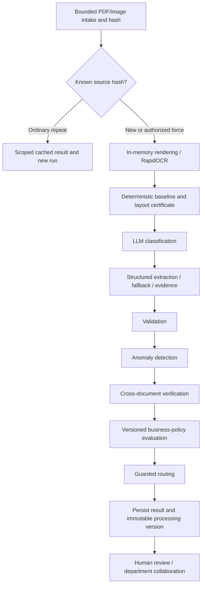

# Implemented processing algorithms

LangGraph orchestrates shared-state stages. Classification and extraction invoke the
configured LLM; validation, anomalies, reconciliation, policies and routing are
deterministic. They are not separate autonomous learned models.

`src/idp/agents/graph.py` defines the order. The policy version is bound during
extraction before validation, while the policy decision stage runs after reconciliation.
Batch completion also deterministically rechecks invoices that arrived before their
POs; that does not imply a new live model call.

Implementation references below are relative to `src/idp/`.

| Algorithm | Inputs → outputs | Decision logic and implementation | Limits |
|---|---|---|---|
| Intake and OCR | PDF/PNG/JPEG bytes → images, text, boxes, confidence | `batch/ingestion.py` checks signatures, dimensions, page/file/batch bounds. `ingestion/page_processor.py` renders PDFs at 2×. `ocr/rapidocr_engine.py` converts RapidOCR output; `ocr/processor.py` joins pages and averages region confidence. | No guaranteed handwriting/table reconstruction; OCR confidence is not field accuracy. |
| Optional preprocessing | Image → transformed image | `preprocessing/image_preprocessor.py`: grayscale, histogram equalization, non-local means denoising, Otsu threshold when requested. | Helpers are not automatically applied by the production baseline; no measured default improvement is claimed. |
| Baseline classification | OCR → type/confidence | `classification/keyword_classifier.py`, `pipeline/document_pipeline.py`: deterministic keyword cues and extractors. | Generic words can confuse it; graph classification is separate. |
| LLM classification | Untrusted OCR → invoice/PO/receipt/contract/unknown | `agents/classification_agent.py`, `llm/schemas.py`: schema-validated structured response; insufficient evidence should yield unknown. | Model confidence is not calibrated correctness. |
| Structured extraction | Class, OCR, baseline → fields/evidence/contract metadata | `agents/extraction_agent.py`: type-specific prompts, null missing values, preserved identifiers/dates/currency, recorded fallback provenance. | Finite scalar schemas, not general table understanding or legal interpretation. |
| Layout-certified fallback | OCR boxes and certificate → missing-field recovery or abstention | `extraction/invoice_extractor.py`, `agents/extraction_agent.py`: seller tax ID requires unique role/layout certification, matching type/seller and OCR support. Never assume first tax ID is seller; preserve populated model fields. Other bounded fallback also requires OCR support. | Ambiguous/conflicting roles must abstain or require review; never copy baseline total blindly. |
| Evidence verification | Fields, quoted evidence, OCR → support/warnings | `utils/evidence.py`, extraction/validation agents: normalize fragments and verify text/candidate support; retain certified role conflicts for review. | Text presence alone cannot prove semantic roles; OCR itself can be wrong. |
| Validation | Fields/evidence/policy → pass/errors/warnings/optional omissions | `agents/validation_agent.py`: required fields, dates, money, arithmetic, evidence and roles. Invoice requires number/date/seller/client/total; PO number/date/vendor; receipt seller/date/total; contract title/parties/effective date. Warnings require review. | Optional absence is separate. Contracts need exactly two distinct OCR-supported parties; unsupported structures, amendments and incomplete extraction require review. Not legal validity. |
| Invoice/PO reconciliation | Invoice + shared organization POs → status/issues/match ID | `verification/cross_document.py`, `agents/cross_document_agent.py`: normalized PO lookup, ambiguity checks, seller/vendor consistency, comparable currency/amount and configured absolute tolerance. | Missing reference is not_checked; noninvoice not_applicable. Unknown/incomplete values cannot establish a safe match. Not full three-way goods-receipt matching. |
| Anomaly rules | Evidence, amount, parties, text → anomalies/risk | `agents/anomaly_agent.py`: unverified evidence, negative/high amounts, identical parties and instruction-like text with deterministic rules/thresholds. | No trained fraud detector; risk is a review signal. |
| Business policy | Bound policy/version + state → passed/failed rules | `policy/schema.py`, `policy/service.py`: protected fields, currency thresholds, tolerances, required PO/expiry, duplicate IDs, escalation, preview then activation. | Cannot remove protected checks or authorize transactions. No FX conversion. Binding/evaluation errors fail toward review. |
| Routing | Validation/risk/reconciliation/policy → status/team/reason | `agents/routing_agent.py`: unknown to Document Operations; invalid/unresolved to Document Review; remaining high risk to Risk Review; only valid low-risk supported documents reach configured department queues. | Department eligibility never executes payment or contract approval. |
| Guarded human review | Fresh revision, principal, reason, evidence → case/event/revision | `review/service.py`: optimistic concurrency, unclaimed/self-assigned guards, Admin-only assignment, correction/revalidation, bounded handoff and immutable originals. | Read-only references confer no edit rights; Admin cannot bypass mandatory approval safeguards. |
| Duplicates and batches | Bytes/request key/actor → durable jobs/items/attempts/runs | `batch/service.py`, `storage/repository.py`, `pipeline/agentic_pipeline.py`: SHA-256, idempotent submission, per-item retry history, OS worker lock, restart recovery and cached repeats. Authorized force creates a new processing version. Verified retained sources can be reused. | Business IDs differ from byte identity; distinct sources sharing IDs require review. Serial local worker, not distributed execution. |

`llm/provider.py` uses structured JSON, temperature zero, a 45-second request timeout
and at most three transient attempts per structured call with bounded backoff.
Authentication/malformed-request statuses are not retried indefinitely. A schema-invalid
response can receive one repair attempt. Model name is configurable; no keys are logged.

Original milestone guides, experiment manifests and `research/tools/` retain source
attribution and reproducibility. Synthetic convenience samples and cached responses
do not establish industrial accuracy, time savings, novelty or generalization. No
historical model output or evaluation is overwritten by these guides.
