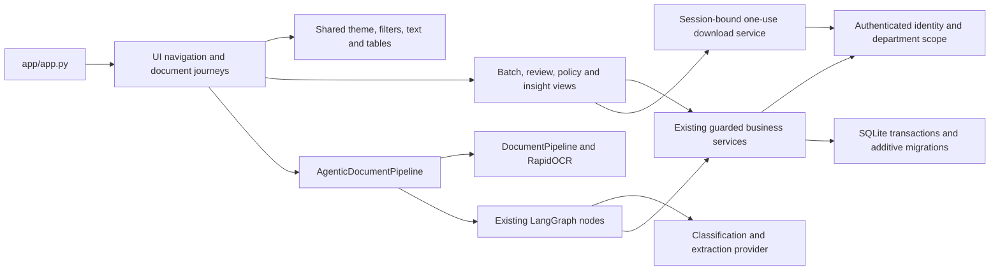

# Application architecture and controlled UI refactor

## React migration branch (2026-10-15)

The React upload flow accepts one or many files through the same form. File checks
precede explicit AI/source-retention consent and durable job submission; processing
then starts automatically. The Processing jobs view monitors saved progress and
supports explicit recovery/retries. Repository, human review and analytics remain
the ongoing workspace. Current limits are 50 files / 100 MB per upload and 20 MB
per file, with PDF/PNG/JPEG input. The legacy single-document API remains compatible.

The implemented path is ingestion/OCR, classification, extraction, validation,
anomaly detection, cross-document verification, business policy and routing,
followed by persisted department/human review and scoped analytics/export.
Post-job deterministic reconciliation handles an invoice uploaded before its PO.
External ERP/CRM connectors and automatic model retraining are not implemented;
stored human corrections and evaluation artifacts do not by themselves train a model.

`codex/react-ui-cleanup` is the review candidate for replacing Streamlit presentation
with React, TypeScript, Vite, Tailwind and Radix tabs. It uses a thin same-origin
FastAPI adapter in `src/idp/web/api.py`; existing AI, policy, review, batch, security
and storage services remain unchanged. The previous Streamlit checkpoint and its
entry point are retained during acceptance; do not retire them before parity and
owner approval. No merge is authorized by this document.

The adapter binds only to loopback, uses HttpOnly/SameSite cookies and validates
same-origin mutations. Each request uses a session-scoped repository; user-supplied
actors, internal capabilities and database paths are never accepted. Downloads keep
the existing one-use, expiring, hash-verified service and additionally require the
requesting browser to own the grant. Access logs are disabled to avoid grant URLs.

From the project root, build with `npm --prefix frontend ci` followed by
`npm --prefix frontend run build`, then start with
`uv run --frozen --python 3.14.6 python -m idp.web.api` (localhost port 8000).
Set `IDP_DATABASE_PATH` to an isolated database for acceptance. Existing account
bootstrap and worker commands are unchanged. No shared default account is created.

The scripts directory now contains only five entry points: `batch_worker.py`,
`manage_security.py`, `process_document.py`, `run_agents.py`, and `run_tests.py`.
All 12 component test modules plus `_test_support.py` moved to `tests/components/`;
`scripts/run_tests.py` retains the existing component-test command. Integration and
HTTP adapter tests remain under `tests/`. All 15 offline evaluation, dataset and
human-study tools moved together to `research/tools/`; run them from the project
root using their new path. Active milestone guides use the new paths. Historical
reports intentionally retain original paths and fingerprints; the release tag
`v0.1.0-research.m7` reproduces the original layout. Private `research_sources/`
archives and `data/` and `results/` artifacts have not moved or changed.

Cleanup classification: relocating tests and research tools is **SAFE TO MERGE**
after regression checks; original test cases and research functions are retained.
Agents, services, migrations, worker commands, legacy CLI adapters and research
evidence are **MUST PRESERVE**. `ocr/paddle_parser.py` and broader service/dependency
removal **REQUIRE MORE EVIDENCE** because public/compatibility use cannot be excluded.
No whole-file implementation or evidence deletion is proposed.

The sections below record the earlier Streamlit checkpoint and its historical
acceptance results; they are not claims about the new React candidate.

The product remains a single Streamlit application over the existing Python services.
Entry point: `app/app.py`. The refactor branch is `codex/final-product-refactor`, based
on `44f9c80`. No commit, tag or push is part of this delivery. README files, original
databases, processing evidence, research sources and prior results are preserved.

## Stack decision and scope

Keep Streamlit. React/FastAPI would require a new session transport, request/CSRF
boundary, protected-download delivery, validated upload endpoints, review revision
contracts, worker progress endpoints and a second build toolchain. That is a larger
migration than a controlled final refinement. No FastAPI feasibility claim was made,
no API routes were added and no competing production frontend exists.

The inventory covered 132 tracked files, 82 Python source modules and 196 project
import edges before editing. The full source dependency map is local evidence at
`results/product_refactor_20261015/dependency_map.mmd`; it includes deferred imports,
so a graph cycle alone is not an import-time failure. Shared UI helpers previously
imported through the console now live in `ui/presentation.py`. Two deferred links to
the console's document renderer remain in batch/review views; changing service-level
lazy imports or public legacy interfaces needs stronger evidence and is out of scope.



The workflow remains intake → OCR → classification/extraction → hybrid evidence
checks → validation → anomalies → cross-document verification → business policy →
routing → guarded human review. Existing policy binding and version pinning are
unchanged. No extraction prompt, schema, provider, agent, migration or service changed.

## Current versus final structure

| Before | Refactored ownership |
| --- | --- |
| Nine permanent destinations plus Accounts | Five permission-filtered destinations with contextual views |
| Console-owned formatting, filters and CSS reused through console imports | `ui/presentation.py`; no service mutations or permission decisions |
| Fixed-height numeric metrics for long workflow text | Wrapping plain-text status cards |
| One dense extraction table | Grouped identity, parties, dates and amounts; inspectable evidence/provenance |
| All financial/operational charts shown together | Financial and Operations views; one selected breakdown at a time |
| Repeated policy tables and raw routing codes | Plain-language failures visible; full technical record on demand |
| Duplicate unused fake-provider classes | Existing `_test_support` fixture retained; unused copies removed |

Navigation: Overview; Documents (Repository, Upload, Batches); My Work (Review queue,
Department work); Insights (Financial, Operations); Administration (Policies, People,
Audit & settings). Child permissions are checked before rendering and again by the
existing services. Reviewers do not receive upload/batch/admin controls. Auditors
retain authorized history access without review mutations. All users keep their own
password change and sign-out controls under My account. Backend role scopes are the
authority, not navigation visibility.

Authorized retained sources continue to open through the protected download flow.
Authenticated source bytes are not put into Streamlit public media storage. There is
no newly introduced inline public source viewer. Missing retained sources keep a clear
empty state. Processing originals, OCR diagnostics and policy details remain inspectable.

## Cleanup decisions and risks

| Candidate | Classification | Evidence / action |
| --- | --- | --- |
| Shared UI formatting/filter/style definitions | SAFE TO MERGE | Moved once; callers updated; all old journeys tested |
| Two unused FakeLLM copies in component test files | SAFE TO REMOVE | No imports/references; fixtures already use `_test_support`; no test methods removed |
| Unused imports in those test files | SAFE TO REMOVE | AST load/reference check and full regressions |
| Agents, extraction, review/policy/security services, migrations and worker | MUST PRESERVE | Safety, transaction, API/CLI and research boundaries; no edits |
| Research scripts and historical milestone guides | MUST PRESERVE | Existing commands/artifact references and reproducibility |
| Legacy AgentDocumentService / process_document / run_agents entrypoints | MUST PRESERVE | Existing CLI or integration use; not a duplicate production web UI |
| PaddleResultParser module | REQUIRES MORE EVIDENCE | No internal caller found; public compatibility use cannot be excluded; retained |
| Shared JSON serializer across all layers | REQUIRES MORE EVIDENCE | Snapshots, exports and provider schemas have different semantics; not merged |
| Dependency removal / repository rewrite | REQUIRES MORE EVIDENCE | Direct dependencies support runtime or retained research/tests; no lockfile changes |

Exact whole-file deletion inventory: **none**. No tests, migrations, evaluators or
historical files were deleted. Risk estimates: navigation/widget-state changes were
medium risk (tested with authenticated roles, cross-document editor isolation and UI
actions); CSS/formatting low-to-medium risk (actual browser plus human desktop check);
backend behavior low regression risk because its source is unchanged, still tested.
Deferred broad service/API cleanup and a frontend migration would be high risk here.

## Developer entry points

| Change | Location and reason |
| --- | --- |
| Theme, safe text, status cards, grouping, filters and tables | `src/idp/ui/presentation.py` |
| Destinations and document intake/detail/history | `src/idp/ui/console.py` |
| Review, batches, policies, insights and account forms | Corresponding modules in `src/idp/ui/` |
| HTTP API routes | None; do not expose private repository/internal capabilities as browser APIs |
| Agent ordering/nodes | `src/idp/agents/graph.py` and node modules |
| OCR / deterministic extraction / hybrid extraction | `ocr/`, `pipeline/document_pipeline.py`, `extraction/`, `agents/extraction_agent.py` |
| Business rules and versioning | `policy/schema.py`, `policy/service.py` |
| Revision-bound review actions | `review/service.py` |
| Authentication, scopes, source protection | `security/`; UI only delegates |
| Persistence and additive schema changes | `storage/repository.py` and retained migration modules |
| Component / integration tests | `scripts/test_*.py` / `tests/test_*.py`; retain separate scopes |
| Offline research evaluators | `scripts/research_*.py`, `evaluate_*.py`, preparation/study scripts; never imported into app startup |

Windows commands from the project root:

```powershell
uv sync --frozen --python 3.14.6
uv run --frozen --python 3.14.6 python scripts/manage_security.py bootstrap
uv run --frozen --python 3.14.6 streamlit run app/app.py
uv run --frozen --python 3.14.6 python scripts/run_tests.py
uv run --frozen --python 3.14.6 python -m unittest discover -s tests -p 'test_*.py' -v
```

Bootstrap only an unconfigured database, using the CLI's private password prompt.
For a custom database set `IDP_DATABASE_PATH` and pass the same path with the existing
`--database` option to `manage_security.py` / `batch_worker.py`. The explicit worker
command remains `uv run --frozen --python 3.14.6 python scripts/batch_worker.py
--database <isolated-db-path> --max-items 50`. The CLI is trusted local operation,
not a public endpoint. Existing `.env`/secret handling and local-file permissions apply.

## Verification and feature parity

Actual logs and private evidence: `results/product_refactor_20261015/`. The baseline
passed 121 component and 11 integration tests. The final build passed 123 component
tests (64.452 s) and 11 integration tests (7.364 s). Two new UI tests cover wrapping
status/field text and safe rendering of model-supplied evidence labels. All original
test methods remain. Component model responses are simulated; existing integration
PDF tests use real RapidOCR with simulated model output.

| Capability | Executed acceptance evidence |
| --- | --- |
| Login/logout, expiry, role navigation | Security suite's session/login/logout tests; real browser admin/Finance login, refresh and logout |
| Unauthorized/cross-department reads/writes | Security document-ID, scope, forged-actor and reviewer-denial tests; real Finance UI shows 3 scoped records and no admin/upload/batch controls |
| Single intake and hybrid extraction | Existing pipeline/integration tests; separate final live PO/invoice smoke; UI upload control preserved without changing pipeline |
| Mixed batches, progress, failure retry and restart | Batch mixed-order, persisted UI retry/completion, restart and worker-lock tests |
| Repository filters/search/pagination | Operations and batch indexed-search tests; real browser repository read |
| Source access/preview | Authenticated hash-verified source HTTP tests, forged-path/scope/expiry/logout denial tests; protected source controls retained |
| Protected JSON/CSV | Fresh Finance browser downloads: 3 JSON records and 3 CSV data rows, identical IDs/fields; direct file parser verification |
| PO reconciliation and mismatch safety | Pipeline/batch/review tests; actual live matched PO/invoice; browser mismatch details inspected |
| Field correction/evidence/provenance | Review correction, invalid quote, mandatory blank and original-preservation tests |
| Approve/reject/correction/escalation | Guarded decision/revision tests; real browser unsupported-contract approval blocked and needs_correction persisted |
| Claim/assignment/department work | Review case-management, team queues, ownership and stale-revision tests |
| Policy drafts/preview/activation/rollback | Policy UI action and backend activation/pinning/rollback/stale-preview tests |
| Financial/operational analytics | Currency/decision separation and denominator tests; real browser Financial/Operations views |
| Audit history/originals | Immutable event/version tests, read-only auditor UI tests and history reload tests |
| User administration/password/session revocation | Security account creation/update/last-admin/revocation tests; guarded People view smoke |
| Security and retention | Retention confirmation, active-case/source preservation and additive migration tests; no cleanup executed on original data |

The final live smoke executed real RapidOCR and Groq on two familiar fictional
development PDFs in a new database: 11/11 annotated fields, both classifications,
validations and routes correct; invoice matched PO; persistence and duplicate reuse
without new calls passed. Four logical model calls. No held-out/generalization claim.

Browser evidence: actual 947-pixel viewport despite a requested 1440 override; no
document-wide horizontal overflow observed and workflow text has pre-wrap with no
horizontal truncation. Actual screenshots are saved. The owner additionally verified
Workflow and all five destinations in maximized Edge at 100% zoom using the earlier
1920×1080 / Windows 125% settings (nominal logical width 1536). That human check used
a new private copy of the previous five-record acceptance DB; automated browsing used
six synthetic records. Neither modified original data or ran new inference by browsing.

Limits: **exactly 1440 CSS pixels was not instrumented; dark-mode visual acceptance,
mobile acceptance, formal contrast/keyboard audit, and every action in a real browser
remain unverified**. Native theme colors/appearance are retained; no claim of complete
accessibility certification or exhaustive visual acceptance. Passing a rendered control
alone is not counted as functional acceptance; the matrix identifies action tests and
distinguishes browser checks from simulated-provider integration. Final visual sign-off
at the exact requested viewport remains outstanding, not an application feature deletion.
