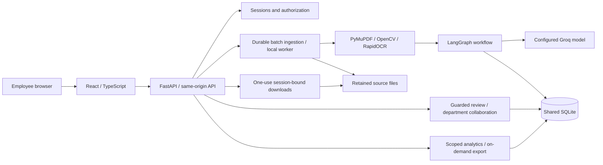
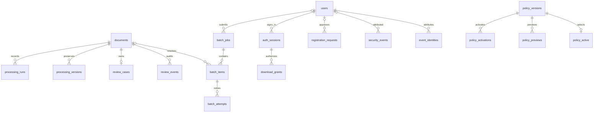
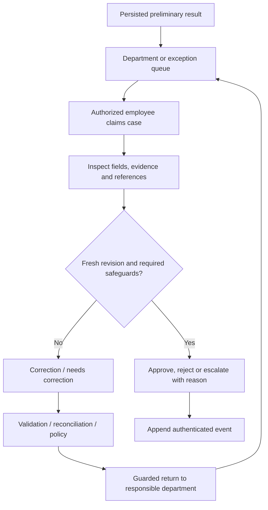

# System architecture

One organization shares one SQLite database. Employees have individual Argon2id
credentials and department-scoped access, never shared departmental passwords.
React + TypeScript is the production frontend; Vite compiles it, with existing
Tailwind integration, Radix tabs and Lucide icons. FastAPI serves the built frontend
and same-origin API. Streamlit has no current source, dependency or runtime role.

## Active source responsibilities

| Path | Responsibility |
|---|---|
| `frontend/src/` | Overview, Documents, My Work, Insights, Administration |
| `src/idp/web/api.py` | Loopback API and frontend hosting; session boundaries |
| `security/` | Authentication, row scopes, downloads, conservative retention |
| `ingestion/`, `ocr/`, `preprocessing/` | Loading, in-memory rendering/OCR; optional preprocessing |
| `classification/`, `extraction/`, `validation/` | Tested deterministic baseline helpers |
| `agents/`, `pipeline/`, `llm/` | Shared-state graph, hybrid orchestration, bounded provider requests |
| `verification/`, `policy/` | Invoice/PO reconciliation and versioned deterministic rules |
| `review/`, `batch/`, `storage/` | Handoffs, durable jobs, repositories/migrations/analytics |
| `scripts/` | Five compatible operational/diagnostic/test entry points |
| `tests/components/`, `tests/test_*.py` | Component and HTTP/pipeline regression suites |
| `research/tools/` | Offline evaluators/study tools; not automatic startup |
| `docs/architecture/`, `docs/algorithms/` | Current guidance |

Backend subpaths are relative to `src/idp/`. Do not move modules for symmetry: the
baseline and compatibility facade have current tests/research callers. Historical
notebooks/reports are not automatically dead code.

## Permissions

All active roles can manage their own password. Pending requests are not active
accounts and receive no organization access. Server-side checks are authoritative.

| Role | Scope | Intake | Review / assignment | Read, source and export |
|---|---|---|---|---|
| Administrator | Organization-wide | All types; forced reprocessing | Guarded review; assign others; manage users/policy/governance | All documents, sources, analytics and exports |
| Finance Reviewer | Finance | Invoices; own jobs | Claim/review own department; guarded handoff; no assigning others | Scoped documents/analytics/source/export; permitted read-only PO references |
| Procurement Reviewer | Procurement | POs; own jobs | Claim/review own department; guarded handoff; no assigning others | Scoped documents/analytics/source/export; permitted read-only invoice references |
| Expense Reviewer | Expense Processing | Receipts; own jobs | Claim/review own department; no assigning others | Scoped documents/analytics/source/export and permitted references |
| Legal Reviewer | Legal | Contracts; own jobs | Claim/review own department; no assigning others | Scoped documents/analytics/source/export and permitted references |
| Document Reviewer | Document Review | All supported types; own jobs | Guarded correction/return; claim own department; no assigning others | Scoped documents/analytics/source/export and permitted references |
| Auditor | Explicit departments | None | None | Read-only documents/history/analytics; no source or export |
| Operations Manager | Explicit departments | None | None | Scoped analytics and analytics export only; no documents/source |

References confer no edit rights. Reviewers cannot mutate another employee's assigned
case. Actor identity comes from the session. Original routing and current ownership
remain separate. Exact predicates: `security/access.py`, `review/service.py`.

Navigation uses the same server-issued permissions: Overview/Insights require
`analytics`, Documents requires `documents`, My Work requires `review`, Administration
requires `security_audit`. These checks hide irrelevant destinations; API/services
and repository scopes remain authoritative. Administrators see pending requests and
intake, reviewers receive department-specific home guidance and queues, Auditors get
read-only history guidance, and Operations Managers default to operational insights.
Existing scoped upload and reference-document workflows remain available.

Public registration stores a requested department, never an approved role. Requests
cannot create sessions. Only an authenticated Administrator can approve a server-valid
role/scope or decline a current request. See operations for migration/decline semantics.

`frontend/src/presentation.ts` centralizes display labels and safe failure guidance.
Document details distinguish validation failures, purchase-order discrepancies, policy
escalations and human decisions, with recorded reasons and next steps. Source evidence,
recognized text and original extracted values remain inspectable on demand. Administrator
diagnostics display an allowlist of confidence/stage metadata, never raw model responses,
credentials or source paths. These transformations do not alter persisted outputs,
financial calculations, extraction prompts, orchestration, routing or approval safeguards.

## Persistence and migration lifecycle

`DocumentRepository` creates base schema then additive/idempotent batch, review,
policy, security, collaboration, onboarding and department-request migrations. Populated legacy stores
receive migration-specific backups where implemented. Never initialize an application
repository for a read-only historical audit: construction can migrate the database.

Principal relationships are shown, not every column. Historical provenance may be
null. `document_search` supports retrieval; `login_limits` bounds attempts;
`setup_authorizations` stores a digest/expiry. Actor JSON snapshots supplement FKs.
Append-only triggers preserve processing versions and review/policy/security evidence.

## Boundaries and limitations

Same-origin mutation checks, HttpOnly/SameSite cookies, 15-minute idle/one-hour
absolute expiry, revocation and current scopes apply. Downloads are one-use,
30-second, session-bound grants with source-hash checks. Malformed request responses
do not echo credentials. There is no public Administrator signup, automatic training,
fraud model or ERP integration. Department routing does not authorize payments/legal
execution, and Administrator authority does not bypass guarded approval rules.

Loopback binding and HTTP cookie settings are for the local prototype. SQLite and
backups are not encrypted; host protection matters. TLS, MFA and public deployment
need a separate review. Consented processing sends OCR text to Groq. No accuracy,
productivity or production-security claim follows from the architecture alone.
